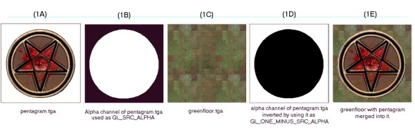

\pagebreak
# Alpha Channels

To use some blend modes of alphaFunc, you must add an alpha channel to
your texture files. Photoshop can do this. Paintshop Pro has the ability
to make an alpha channel but cannot work directly in to it. In Photoshop
you want to set the type to Mask. Black has a value of 255. White has a
value of 0. The darkness of a pixel\'s alpha value determines the
transparency of the corresponding RGB value in the game world. Darker =
more transparent.

Care must be taken when reworking textures with alpha channels. Textures
without alpha channels are saved as 24 bit images while textures with
alpha channels are saved as 32 bit. If you save them out as 24 bit, the
alpha channel is erased. Note: Adobe Photoshop will prompt you to save
as 32, 24 or 16 bit. Choose wisely. If you save a texture as 32 bit and
you don\'t actually have anything in the alpha channel, Quake III Arena
may still be forced to use a lower quality texture format (when in 16
bit rendering) than if you had saved it as 24 bit.

To create a texture that has \"open\" areas, make those areas black in
the alpha channel and make white the areas that are to be opaque. Using
gray shades can create varying degrees of opacity/transparency.

    // Opaque texture with see-through holes knocked in in.
    textures/base_floor/pjgrate1
    {
        surfaceparm metalsteps
        cull none

        // A GRATE OR GRILL THAT CAN BE SEEN FROM BOTH SIDES
        {
            map textures/base_floor/pjgrate1.tga
            blendFunc GL_SRC_ALPHA GL_ONE_MINUS_SRC_ALPHA
            alphaFunc GT0
            depthWrite
            rgbGen identity
        }
        {
            map $lightmap
            rgbGen identity
            blendFunc GL_DST_COLOR GL_ZERO
            depthFunc equal
        }
    }

The alpha channel can also be used to merge a texture (including one
that contains black) into another image so that the merged art appears
to be and opaque decal on a solid surface (unaffected by the surface it
appears to sit on), without actually using an alpha function. The
following is a very simple example:

{.center
tppabs="http://robotrenegade.com/q3map2/docs/shader_manual/_images/alphachannel01.jpg"}

Start with a TGA file image. In this case, a pentagram on a plain white
field (figure 1A). The color of the field surrrounding the image to be
merged is not relevant to this process (although having a hard-edged
break between the image to be isolated and the field makes the mask
making process easier). Make an alpha channel. The area of the image to
be merged with another image is masked off in white. The area to be
masked out (notused) is pure black (figure 1B). The image to be merged
into is greenfloor.tga (figure 1C).

Make a
[qer_editorImage](#qer_editorImage)
of greenfloor.tga. This is placed in the frame buffer as the map image
for the texture. By using GL_SRC_ALPHA as the source part of the blend
equation, the shader adds in only the non-black parts of the pentagram.
Using GL_MINUS_ONE_SRC_ALPHA, the shader inverts the pentagram\'s alpha
channel and adds in only the non-black parts of the green floor.

In a like manner, the alpha channel can be used to blend the textures
more evenly. A simple experiment involves using a linear gradiant in the
alpha channel (white to black) and merging two textures so they appear
to cross fade into each other.

A more complicated experiment would be to take the pentagram in the
first example and give it an aliased edge so that the pentagram appeared
to fade or blend into the floor.
