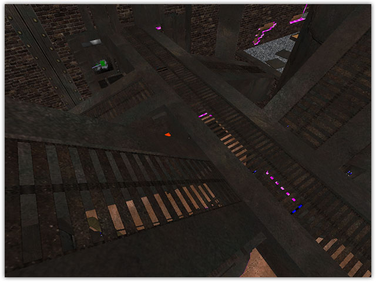

\pagebreak
# Radiant Editor Directives

These directives only affect the texture when it is seen in the Radiant
editor. They have no effect on the surface in-game. They should be
grouped with the surface parameters but ahead of them in sequence.

## qer_editorImage textureName {#qer_editorImage}

This directive instructs editor, which image to use for shader display.
It also defines shader dimensions for editor and compiler, and lastly
shader color to be used in
[q3map_surfaceLight](#q3map_surfaceLight)
and -bounce.

The editor and Q3Map2 map a texture using the size attributes of the
image file used for the editor image. When that editor image represents
a shader, any texture used in any of the shader stages will be scaled up
or down to the dimensions of the editor image. If a 128x128 pixel image
is used to represent the shader in the editor, then a 256x256 image used
in a later stage will be shrunk to fit. A 64x64 image would be stretched
to fit. Be sure to check this on bouncy, acceleration, and power-up pads
placed on surfaces other than 256 x 256. Use [tcMod
scale](#tcModScale) to change the size of the
stretched texture. Remember that tcMod scale 0.5 0.5 will double your
image, while tcMod scale 2 2 will halve it.

    textures/liquids/lavahell2       //path and name of new texture
    {
        qer_editorImage textures/eerie/lavahell.tga  //based on this
        surfaceparm noimpact            //projectiles do not hit it
        surfaceparm lava                //has the game properties of lava
        surfaceparm nolightmap          //environment lighting does not affect
        q3map_surfacelight 3000         //light is emitted
        tessSize 256                    //relatively large triangles
        cull disable                    //no sides are removed
        deformVertexes wave 100 sin 5 5 .5 0.02
        fogparms 0.8519142 0.309723 0.0 128 128
        {
            maptextures/eerie/lavahell.tga  //base texture artwork
            tcMod turb .25 0.2 1 0.02       //texture is subjected to turbulence
            tcMod scroll 0.1 0.1            //the turbulence is scrolled
        }
    }

> #### Design Notes:
>
> The base_light and gothic_light shaders contain numerous uses of this.
> It can be very useful for making different light styles (mostly to
> change the light brightness) without having to create a new piece of
> TGA art for each new shader.

## qer_trans N.N {#qer_trans}

This directive makes brush transparent when seen in the editor and
filterable by \'translucent\' filter (no effect on game rendering at
all). It can have a positive value between 0 and 1. The higher the
value, the less transparent the texture. Example: qer_trans 0.2 means
the brush is 20% opaque and nearly invisible.

> #### Design Notes:
>
> On GtkRadiant 1.4 and earlier, if the shader uses qer_trans and a
> [qer_editorImage](#qer_editorImage)
> with an alpha channel, the transparent areas of the editorImage will
> be 100% transparent. To keep the solid areas of the editorImage
> opaque, use a near 1 value for qer_trans (eg. 0.9999). This is useful
> for grates, windows, fences, etc. If using GtkRadiant 1.5 or later,
> use
> [qer_alphaFunc](#qer_alphaFunc)
> for editorImage masking instead. In NetRadiant-custom any value of
> qer_trans enables alpha channel transparency display, this may be used
> when alpha blending is wanted instead of alpha masking.

## qer_alphaFunc func N.N {#qer_alphaFunc}

This directive is only supported by GtkRadiant 1.5 based editors. This
is used when you have an alpha channel in the editorImage that you want
to appear as an alpha mask in the editor. qer_alphaFunc by itself does
not get filtered with qer_trans. This is useful for grates, windows,
fences, etc.

Supported functions are: equal, greater, less, gequal, lequal.\
Values: positive between 0 and 1.

{.center
tppabs="http://robotrenegade.com/q3map2/docs/shader_manual/_images/qer_alphafunc.jpg"}
