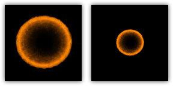
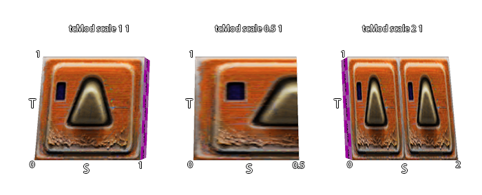

\pagebreak
# Stage Directives

Stage specifications only affect rendering. Changing any directives or
values within a stage will usually take effect as soon as a vid_restart
is executed. Q3Map2 ignores stage directives entirely.

A stage can specify a texture map, a color function, an alpha function,
a texture coordinate function, a blend function, and a few other
rasterization options.

## Texture Map Specification {#map}

### map *texturename*

Specifies the source texture map (a 24 or 32-bit TGA or JPG file) used
for this stage. The texture may or may not contain alpha channel
information. The special keywords \$lightmap and \$whiteimage may be
substituted in lieu of an actual texture map name. In those cases, the
texture named in the first line of the shader becomes the texture that
supplies the light mapping data for the process. The texture name should
always end with the \".tga\" suffix regardless of whether the source
texture map is actually a .tga file or .jpg.

### map *\$lightmap* {#mapLightmap}

This is the overall lightmap for the game world. It is calculated during
the Q3Map2 process. It is the initial color data found in the
framebuffer. Note: due to the use of overbright bits in light
calculation, the keyword [rgbGen
identity](#rgbGenIdentity) must accompany all
\$lightmap instructions.

### map *\$whiteimage*

This is used for specular lighting on MD3 models. This is a white image
generated internally by the game. This image can be used in lieu of
\$lightmap or an actual texture map if, for example, you wish for the
vertex colors to come through unaltered.

### clampMap *texturename* {#clampMap}

Dictates that this stage should clamp texture coordinates instead of
wrapping them. During a [stretch
function](#tcModStretch), the area, which the
texture must cover during a wave cycle, enlarges and decreases. Instead
of repeating a texture multiple times during enlargement (or seeing only
a portion of the texture during shrinking) the texture dimensions
increase or contract accordingly. This is only relevant when using
something like deformTexCoordParms to stretch/compress texture
coordinates for a specific special effect. Remember that the Quake III
Arena engine normalizes all texture coordinates (regardless of actual
texture size) into a scale of 0.0 to 1.0.

When using clampMap make sure the texture is properly aligned on the
brush. The clampMap function keeps the image from tiling. However, the
editor doesn\'t represent this properly and shows a tiled image.
Therefore, what appears to be the correct position may be offset. This
is very apparent on anything with a [tcMod
rotate](#tcModRotate) and clampMap function.

Avoiding Distortion: When seen at a given distance (which can vary,
depending on hardware and the size of the texture), the compression
phase of a stretch function will cause a \"cross\"-like visual artifact
to form on the modified texture due to the way that textures are
reduced. This occurs because the texture undergoing modification lacks
sufficient \"empty space\" around the displayed (non-black) part of the
texture (see below, left). To compensate for this, make the non-zero
portion of the texture substantially smaller (50% of maximum stretched
size \-- see below, right) than the dimensions of the texture. Then,
write a scaling function ([tcMod
scale](#tcModScale)) into the appropriate shader
phase, to enlarge the image to the desired proportion.

**{.center
tppabs="http://robotrenegade.com/q3map2/docs/shader_manual/_images/clampmap.jpg"}**

The shaders for the bouncy pads (in the sfx.shader file) show the
stretch function in use, including the scaling of the stretched texture:

    textures/sfx/metalbridge06_bounce
    {
        surfaceparm nodamage
        q3map_lightimage textures/sfx/jumppadsmall.tga
        q3map_surfacelight 400
        {
            map textures/sfx/metalbridge06_bounce.tga
            rgbGen identity
        }
        {
            map $lightmap
            rgbGen identity
            blendfunc gl_dst_color gl_zero
        }
        {
            map textures/sfx/bouncepad01b_layer1.tga
            blendfunc gl_one gl_one
            rgbGen wave sin .5 .5 0 1.5
        }
        {
            clampmap textures/sfx/jumppadsmall.tga
            blendfunc gl_one gl_one
            tcMod stretch sin 1.2 .8 0 1.5
            rgbGen wave square .5 .5 .25 1.5
        }
    }

### animMap *frequency texture1\... texture8* {#animMap}

The surfaces in the game can be animated by displaying a sequence of 1
to 8 frames (separate texture maps). These animations are affected by
other keyword effects in the same and later shader stages.

frequency
:   The number of frames to display per one second time period (namely
    fps).

texture1\... texture8
:   the texture path/texture name for each animation frame must be
    explicitly listed. Up to eight frames (eight separate .tga files)
    can be used to make an animated sequence. Each frame is displayed
    for 1/frequency seconds.

> #### Example:
>
> animMap 8 textures/sfx/b_flame1.tga textures/sfx/b_flame2.tga
> textures/sfx/b_flame3.tga textures/sfx/b_flame4.tga would be a 4 frame
> animated sequence. Each frame would be displayed for 1/8 of a second
> before the next one is displayed. Whole cycle length would be 0.5
> seconds. The cycle repeats after the last frame in sequence shown.

    textures/sfx/flameanim_blue
    {

        //  ***********************************************
        //  *    Blue Flame                               *
        //  *    July 20, 1999 Surface Light 1800         *
        //  *    Please Comment Changes                   *
        //  ***********************************************
        qer_editorimage textures/sfx/b_flame7.tga
        q3map_lightimage textures/sfx/b_flame7.tga
        surfaceparm trans
        surfaceparm nomarks
        surfaceparm nolightmap
        cull none
        q3map_surfacelight 1800
        // texture changed to blue flame.... PAJ
        {
            animMap 10 textures/sfx/b_flame1.tga textures/sfx/b_flame2.tga
                textures/sfx/b_flame3.tga textures/sfx/b_flame4.tga
                textures/sfx/b_flame5.tga textures/sfx/b_flame6.tga
                textures/sfx/b_flame7.tga textures/sfx/b_flame8.tga
            blendFunc GL_ONE GL_ONE
            rgbGen wave inverseSawtooth 0 1 0 10
        }
        {
            animMap 10 textures/sfx/b_flame2.tga textures/sfx/b_flame3.tga
                textures/sfx/b_flame4.tga textures/sfx/b_flame5.tga
                textures/sfx/b_flame6.tga textures/sfx/b_flame7.tga
                textures/sfx/b_flame8.tga textures/sfx/b_flame1.tga
            blendFunc GL_ONE GL_ONE
            rgbGen wave sawtooth 0 1 0 10
        }
        {
            map textures/sfx/b_flameball.tga
            blendFunc GL_ONE GL_ONE
            rgbGen wave sin .6 .2 0 .6
        }
    }

> #### Design Notes:
>
> To make a texture image appear for an unequal (longer) amount of time
> (compared to other frames), repeat that frame more than once in the
> sequence.

### videoMap *videoname* {#videoMap}

Surfaces marked with a shader containing this directive in one of its
stages will display an animated video playing in a continuous loop. The
video clip must be in ROQ format and playing at 30 frames per second.
The ROQ file is stored in the \"video\" directory within the main mod
directory. A third-party program is required to convert other video
formats to the ROQ format for use within Quake III engine games.

    textures/obsidian_video/intro
    {
        qer_editorImage textures/obsidian_video/qer_intro.tga
        surfaceparm nolightmap
        {
            videoMap obsidian_intro.roq
            rgbGen identity
        }
    }

> #### Historical Information:
>
> The ROQ format is a proprietary video format developed by Graeme
> Devine originally used for \"The 7th Guest\" for the purpose of being
> able to decompress quickly while maintaining high image quality. It
> was later adopted by Id Software for use in Quake III Arena.

## blendFunc *func* {#blendFunc}

Blend functions are the keyword commands that tell the Quake III Arena
graphic engine\'s renderer how graphic layers are to be mixed together.

### Simplified Blend Functions

The most common blend functions are set up here as simple commands, and
should be used unless you really know what you are doing.

add
:   Shorthand command for blendFunc gl_one gl_one. Effects like fire and
    energy are additive.

filter
:   Shorthand command that can be substituted for either blendFunc
    gl_dst_color gl_zero or blendFunc gl_zero gl_src_color. A filter
    will always result in darker pixels than what is behind it, but it
    can also remove color selectively. Lightmaps are filters.

blend
:   Shorthand command for blendFunc gl_src_alpha gl_one_minus_src_alpha.
    This is conventional transparency, where part of the background is
    mixed with part of the texture.

### Explicit Blend Functions

Getting a handle on this concept is absolutely key to understanding all
shader manipulation of graphics.

blendFunc or \"Blend Function\" is the equation at the core of
processing shader graphics. The formula reads as follows:

    [source * (srcBlend)] + [destination * (dstBlend)]

*Source* is usually the RGB color data in a texture TGA file (remember
it\'s all numbers) modified by any rgbGen and alphaGen. In the shader,
the source is generally identified by command map, followed by the name
of the image.

*Destination* is the color data currently existing in the frame buffer.

Rather than think of the entire texture as a whole, it maybe easier to
think of the number values that correspond to a single pixel, because
that is essentially what the computer is processing\... one pixel of the
bitmap at a time.

The process for calculating the final look of a texture in place in the
game world begins with the precalculated lightmap for the area where the
texture will be located. This data is in the frame buffer. That is to
say, it is the initial data in the destination. In an unmanipulated
texture (i.e. one without a special shader script), color information
from the texture is combined with the lightmap. In a shader-modified
texture, the [\$lightmap](#mapLightmap) stage must
be present for the lightmap to be included in the calculation of the
final texture appearance.

Each pass or \"stage\" of blending is combined (in a cumulative manner)
with the color data passed onto it by the previous stage. How that data
combines together depends on the values chosen for the source blends and
destination blends at each stage. Remember it\'s numbers that are being
mathematically combined together that are ultimately interpreted as
colors.

A general rule is that any source blend other than GL_ONE (or
GL_SRC_ALPHA where the alpha channel is entirely white) will cause the
source to become darker.

### Source Blend (srcBlend)

The following values are valid for the *source* blend part of the
equation.

GL_ONE
:   This is the value 1. When multiplied by the source, the value stays
    the same. The value of the color information does not change.

GL_ZERO
:   This is the value 0. When multiplied by the source, all RGB data in
    the source becomes zero (essentially black).

GL_DST_COLOR
:   This is the value of color data currently in the destination (frame
    buffer). The value of that information depends on the information
    supplied by previous stages.

GL_ONE_MINUS_DST_COLOR
:   This is nearly the same as GL_DST_COLOR except that the value for
    each component color is inverted by subtracting it from one. (i.e. R
    = 1.0 - DST.R, G = 1.0 - DST.G, B = 1.0 - DST.B, etc.)

GL_SRC_ALPHA
:   The TGA file being used for the source data must have an alpha
    channel in addition to its RGB channels (for a total of four
    channels). The alpha channel is an 8-bit black and white only
    channel. An entirely white alpha channel will not darken the source.

GL_ONE_MINUS_SRC_ALPHA
:   This is the same as GL_SRC_ALPHA except that the value in the alpha
    channel is inverted by subtracting it from one. (i.e. A=1.0 - SRC.A)

### Destination Blend (dstBlend)

The following values are valid for the *destination* blend part of the
equation.

GL_ONE
:   This is the value 1. When multiplied by the destination, the value
    stays the same the value of the color information does not change.

GL_ZERO
:   This is the value 0. When multiplied by the destination, all RGB
    data in the destination becomes zero (essentially black).

GL_SRC_COLOR
:   This is the value of color data currently in the source (which is
    the texture being manipulated here).

GL_ONE_MINUS_SRC_COLOR
:   This is the value of color data currently in source, but subtracted
    from one (i.e. inverted).

GL_SRC_ALPHA
:   The TGA file being used for the source data must have an alpha
    channel in addition to its RGB channels (for a total of four
    channels). The alpha channel is an 8-bit black and white only
    channel. An entirely white alpha channel will not darken the source.

GL_ONE_MINUS_SRC_ALPHA
:   This is the same as GL_SRC_ALPHA except that the value in the alpha
    channel is inverted by subtracting it from one. (i.e. A=1.0 - SRC.A)

### Doing the Math: The Final Result

The product of the source side of the equation is added to the product
of the destination side of the equation. The sum is then placed into the
frame buffer to become the destination information for the next stage.
Ultimately, the equation creates a modified color value that is used by
other functions to define what happens in the texture when it is
displayed in the game world.

### Default Blend Function

If no blendFunc is specified then no blending will take place. A warning
is generated if any stage after the first stage does not have a
blendFunc specified.

### Technical Information/Limitations Regarding Blend Modes:

The Riva 128 graphics card supports ONLY the following blendmodes:

- GL_ONE, GL_ONE
- GL_DST_COLOR, GL_ZERO
- GL_ZERO, GL_SRC_COLOR
- GL_SRC_ALPHA, GL_ONE_MINUS_SRC_ALPHA
- GL_ONE_MINUS_SRC_ALPHA, GL_SRC_ALPHA

Cards running in 16 bit color cannot use any GL_DST_ALPHA blends.

## rgbGen func {#rgbGen}

There are two color sources for any given shader, the texture file and
the vertex colors. Output at any given time will be equal to TEXTURE
multiplied by VERTEXCOLOR. Most of the time VERTEXCOLOR will default to
white (which is a [normalized value](#normalization)
of 1.0), so output will be TEXTURE (this usually lands in the Source
side of the shader equation). Sometimes you do the opposite and use
TEXTURE = WHITE, but this is only commonly used when doing specular
lighting on entities (i.e. shaders that level designers will probably
never create.

The most common reason to use rgbGen is to pulsate something. This means
that the VERTEXCOLOR will oscillate between two values, and that value
will be multiplied (darkening) the texture.

If no rgbGen is specified, either \"identityLighting\" or \"identity\"
will be selected, depending on which blend modes are used.

### rgbGen identity {#rgbGenIdentity}

Colors are assumed to be all white (1.0, 1.0, 1.0). All filters stages
(lightmaps, etc) will get this by default.

### rgbGen identityLighting

Colors will be (1.0, 1.0, 1.0) if running without overbright bits (NT,
Linux, windowed modes), or (0.5, 0.5, 0.5) if running with overbright.
Overbright allows a greater color range at the expense of a loss of
precision. Additive and blended stages will get this by default.

### rgbGen vertex {#rgbGenVertex}

Colors are filled in directly by the color data baked to vertices of the
map or model files.

> #### Design Notes:
>
> rgbGen vertex should be used when you want the RGB values to be
> computed for a static model (i.e. mapobject) in the world using
> precomputed static lighting from Q3BSP. This would be used on things
> like the gargoyles, the portal frame, skulls, and other decorative
> models put into the Quake III Arena world.

### rgbGen oneMinusVertex

As rgbGen vertex, but inverted. This keyword would probably not be used
by a level designer.

### rgbGen exactVertex

Like vertex, except vertex ignores overbrightbits. Engine uses this mode
in default shaders for vertexlit surfaces. Generally brighter under
default settings.

### rgbGen entity

Colors are grabbed from the entity\'s modulate field. This is used for
things like explosions. This keyword would probably not be used by a
level designer.

### rgbGen oneMinusEntity

As rgbGen entity, but inverted.

### rgbGen lightingDiffuse

Vertex colors are dynamically computed from lightgrid BSP data using a
standard diffuse lighting equation. It also uses the vertex normals to
illuminate the object correctly.

> #### Design Notes:
>
> rgbGen lightingDiffuse is used when you want the RGB values to be
> computed for a dynamic model. It only functions on MD3 gamemodels
> (those loaded directly by the game, not baked into the BSP). They are
> namely items, characters, weapons, and models which are attached to
> movers via model2 key. rgbGen lightingDiffuse is the default lighting
> mode for these.

### rgbGen wave *func base amplitude phase freq* {#rgbGenWave}

Colors are generated using the specified waveform. An affected texture
will become darker and lighter, but will not change hue. Hue stays
constant. Note that the RGB values for color will not go below 0 (black)
or above 1 (white). Valid waveforms are sin, triangle, square, sawtooth,
inversesawtooth and noise (see [Waveform
Functions](#waveformfunctions)).

### rgbGen const ( *R G B* )

A constant vertex colour is assigned to the affected surface. This
modifies the hue of the texture.

## alphaGen func {#alphaGen}

The alpha channel can be specified like the RGB channels. If not
specified, it defaults to 1.0.

### alphaGen lightingSpecular

### alphaGen wave

All [waveform functions](#waveformfunctions) except
*noise*.

### alphaGen entity

### alphaGen oneMinusEntity

### alphaGen vertex {#alphaGenVertex}

Baked alpha value is read from surface vertices.

### alphaGen oneMinusVertex

Same as above, but (1.0 - value).

### alphaGen const N.N

A constant vertex alpha is assigned to the affected surface. This
modifies the transparency of the texture.

### alphaGen portal *distance*

This rendering stage keyword is normally used in conjunction with the
surface parameter keyword [portal](#portal). It
is mandatory for portals to work (but not for mirrors). The function
accomplishes the \"fade\" that causes the scene in the portal/mirror to
fade from view. Specifically, it means \"Generate alpha values based on
the distance from the viewer to the portal\". Viewer distance 0 maps to
alpha 0, when distance is more than \"distance\" parameter value, alpha
is 1. While latter is the case, portal/mirror content is not rendering
at all, this optimization is original purpose of the keyword, though it
may be utilized for other distance dependent effects.

Basic fading portal/mirror shader example:

    textures/ztest/portal
    {
        qer_editorimage textures/sfx/portalfog.tga
        surfaceparm nolightmap
        portal
        {
            map textures/sfx/portalfog.tga
            blendFunc blend
            alphaGen portal 256
            depthWrite
        }
    }

## tcGen coordinateSource {#tcGen}

Specifies how texture coordinates are generated and where they come
from. Valid functions are base, lightmap, environment and vector.

base
:   Base texture coordinates from the original art.

lightmap
:   Lightmap texture coordinates.

environment
:   Projects a texture from environment mapping (typically used for
    shiny reflective surfaces like polished steel).

vector
:   Projects a texture from a specified direction.

### tcGen vector ( *sx sy sz* ) ( *tx ty tz* ) {#tcGenVector}

New texture coordinate generation by world projection. This allows you
to project a texture onto a surface in a fixed way, regardless of its
orientation.

S-coordinates correspond to the \"x\" coordinates on the texture itself.
T-coordinates correspond to the \"y\" coordinates on the texture itself.
The measurements are in game units.

Example:

    tcGen vector ( 0.01 0 0 ) ( 0 0.01 0 )

This would project a texture with a repeat every 100 units across the
X/Y plane. The value comes from dividing the game units from 1, in this
case, 1/100.

## tcMod *func* {#tcMod}

Specifies how texture coordinates are modified after they are generated.
The valid functions for tcMod are rotate, scale, scroll, stretch,
transform and turb. Transform is a function generally reserved for use
by programmers who suggest that designers leave it alone. When using
multiple tcMod functions during a stage, place the scroll command last
in order, because it performs a mod operation to save precision, and
that can disturb other operations. Texture coordinates are modified in
the order in which tcMods are specified. In otherwords, if you see the
following, the texture coordinates will be scaled, then scrolled.

    tcMod scale 0.5 0.5
    tcMod scroll 1 1

### tcMod rotate *degrees/sec* {#tcModRotate}

This keyword causes the texture coordinates to rotate. The value is
expressed in degrees rotated each second. A positive value means
clockwise rotation. A negative value means counterclockwise rotation.
For example \"tcMod rotate 5\" would rotate texture coordinates 5
degrees each second in a clockwise direction. The texture rotates around
the center point of the texture map, so you are rotating a texture with
a single repetition, be careful to center it on the brush (unless
off-center rotation is desired).

### tcMod scale *sScale tScale* {#tcModScale}

Resizes (enlarges or shrinks) the texture coordinates by multiplying
them against the given factors of sScale and tScale. The values \"s\"
and \"t\" conform to the \"x\" and \"y\" values (respectively) as they
are found in the original texture. A positive value less than one will
increase the size of the texture. A value greater than 1.0 will reduce
the texture to a fraction of its size and cause it to repeat within the
same area as the original texture (Note: see
[clampMap](#clampMap) for ways to control this).

{.center}

### tcMod scroll *sSpeed tSpeed*

Scrolls the texture coordinates with the given speeds. The values \"s\"
and \"t\" conform to the \"x\" and \"y\" values (respectively) as they
are found in the original texture TGA. The scroll speed is measured in
\"textures\" per second. A \"texture\" is the dimension of the texture
being modified and includes any previous shader modifications to the
original TGA). A negative s value would scroll the texture to the left.
A negative t value would scroll the texture down.

Example: tcMod scroll 0.5 -0.5 moves the texture down and right
(relative to the TGA files original coordinates) at the rate of a half
texture each second of travel.

This should be the LAST tcMod in a stage. Otherwise there may be a
popping or snapping visual effect in some shaders.

### tcMod stretch *func base amplitude phase frequency* {#tcModStretch}

Stretches the texture coordinates with the given function. Stretching is
defined as stretching the texture coordinate away from the texture
center closest to the polygon center and then compressing it towards the
center (see [Waveform
Functions](#waveformfunctions)).

### tcMod transform *m00 m01 m10 m11 t0 t1*

Transforms each texture coordinate as follows:

    S' = s * m00 + t * m10 + t0
    T' = s * m01 + t * m11 + t1

Essentially this is two rows of 3x3 matrix, which transforms 2D texture
coordinate. Identity (no-transform) transform is:

    tcMod transform 1 0 0 1 0 0

### tcMod turb *base amplitude phase frequency*

Applies turbulence to the texture coordinate. Turbulence is a back and
forth churning and swirling effect on the texture.

base
:   Undefined

amplitude
:   This is essentially the intensity of the disturbance or twisting and
    squiggling of the texture.

phase
:   See the explanation for phase in [Waveform
    Functions](#waveformfunctions).

frequency
:   Frequency. This value is expressed as repetitions or cycles of the
    wave per second. A value of one would cycle once per second. A value
    of 10 would cycle 10 times per second. A value of 0.1 would cycle
    once every 10 seconds.

## depthFunc *func* {#depthFunc}

This controls the depth comparison function used while rendering. The
default is \"lequal\" (Less than or equal to) where any surface that is
at the same depth or closer of an existing surface is drawn. This is
used for textures with transparency or translucency. Under some
circumstances you may wish to use \"equal\", e.g. for light-mapped
grates that are alpha tested (it is also used for mirrors).

## depthWrite {#depthWrite}

By default, writes to the depth buffer when depthFunc passes will happen
for opaque surfaces and not for translucent surfaces. Blended surfaces
can have the depth writes forced with this function.

## detail

This feature was not used in Quake III Arena maps, but still functions.
Designates this stage as a detail texture stage, which means that if the
c_var r_detailtextures is set to 0 then this stage will be ignored
(detail will not be displayed). This keyword, by itself, does not affect
rendering at all. If you do put in a detail texture, it has to conform
to very specific rules. Specifically, the blendFunc:

    blendFunc GL_DST_COLOR GL_SRC_COLOR

This is also the simple blend function: blendFunc filter

And the average intensity of the detail texture itself must be around
127.

Detail is used to blend fine pixel detail back into a base texture whose
scale has been increased significantly. When detail is written into a
set of stage instructions, it allows the stage to be disabled by the
c_var console command setting \"r_detailtextures 0\".

A texture whose scale has been increased beyond a 1:1 ratio tends not to
have very high frequency content. In other words, one texel can cover a
lot of real estate. Frequency is also known as \"detail.\" Lack of
detail can appear acceptable if the player never has the opportunity to
see the texture at close range. But seen close up, such textures look
glaringly wrong within the sharp detail of the Quake III Arena
environment. A detail texture solves this problem by taking a noisy
\"detail\" pattern (a tiling texture that appears to have a great deal
of surface roughness) and applying it to the base texture at a very
densely packed scale (that is, reduced from its normal size). This is
done programmatically in the shader, and does not require modification
of the base texture. Note that if the detail texture is the same size
and scale as the base texture that you may as well just add the detail
directly to the base texture. The theory is that the detail texture\'s
scale will be so high compared to the base texture (e.g.; 9 detail
texels fitting into 1 base texel) that it is literally impossible to fit
that detail into the base texture directly.

For this to work, the rules are as follows:

- The lightmap must be rendered first. This is because the subsequent
  detail texture will be modifying the lightmap in the framebuffer
  directly.
- The base texture must be rendered next.
- The detail texture must be rendered last since it modifies the
  lightmap in the framebuffer. There is a bug in Quake III that disables
  all stages in a shader after a \"detail\" stage if r_detailTextures is
  set to 0.
- The detail texture MUST have a mean intensity around 127-129. If it
  does not then it will modify the displayed texture\'s perceived
  brightness in the world.
- The detail shader stage MUST have the \"detail\" keyword or it will
  not be disabled if the user uses the \"r_detailtextures 0\" setting.
- The detail stage MUST use \"blendFunc GL_DST_COLOR GL_SRC_COLOR\". Any
  other BlendFunc will cause mismatches in brightness between detail and
  non-detail views.
- The detail stage should scale its textures by some amount (usually
  between 3 and 12) using \"[tcMod
  scale](#tcModScale)\" to control density. This
  roughly corresponds to coarseness. A very large number, such as 12,
  will give very fine detail, however that detail will disappear VERY
  quickly as the viewer moves away from the wall since it will be MIP
  mapped away. A very small number, e.g. 3, gives diminishing returns
  since not enough is brought in when the user gets very close. I\'m
  currently using values between 6 and 9.5. You should use non-integral
  numbers as much as possible to avoid seeing repeating patterns.
- Detail textures add one pass of overdraw, so there is a definite
  performance hit.
- Detail textures can be shared, so designers may wish to define only a
  very small handful of detail textures for common surfaces such as
  rocks, etc.

An example (non-existent) detail shader is as follows:

    textures/bwhtest/foo
    {
        q3map_globalTexture  //may be required when using tcMod scale in later stages

        // draw the lightmap first
        {
            map $lightmap
            rgbGen identity
        }

        // draw the base texture
        {
            map textures/castle/blocks11b.tga
            blendFunc filter
        }

        // highly compressed detail texture
        {
            map textures/details/detail01.tga
            blendFunc GL_DST_COLOR GL_SRC_COLOR //MUST BE USED
            detail   //allows detail shaders to be disabled
            tcMod scale 9.1 9.2
        }
    }

## alphaFunc *func* {#alphaFunc}

Determines the alpha test function used when rendering this map. Valid
values are GT0, LT128, and GE128. These correspond to \"GREATER THAN
0\", \"LESS THAN 128\", and \"GREATER THAN OR EQUAL TO 128\". This
function is used when determining if a pixel should be written to the
framebuffer. For example, if GT0 is specified, the only the portions of
the texture map with corresponding alpha values greater than zero will
be written to the framebuffer. By default alpha testing is disabled.

Both alpha testing and normal alpha blending can be used to get textures
that have see-through parts. The difference is that alphaFunc is an
all-or-nothing test, while blending smoothly blends between opaque and
translucent at pixel edges. Alpha test can also be used with depthWrite,
allowing other effects to be conditionally layered on top of just the
opaque pixels by setting [depthFunc](#depthFunc) to
equal.
