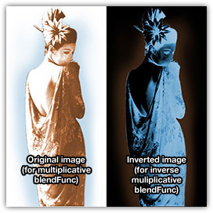
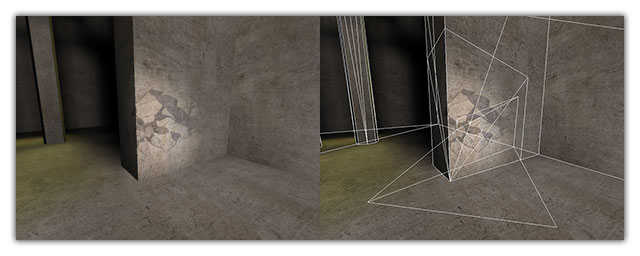

# Advanced Decal Tricks 101

## Multiplicative Decals

Instead of doing blended or additive decals, sometimes the best effect
is actually a multiply:

    blendFunc GL_DST_COLOR GL_ZERO

The source texture is white with yellow/blue (or whatever) arrow on it.
Combined with [polygonOffset](#polygonOffset) and
perhaps a [sort key](#sort), this can be a great
way to get a decal effect that works okay with bullet marks and player
shadows.

## Inverse Multiplicative Shadows

While the above trick works well 95% of the time, sometimes you need to
use fog. In order for a multiplicative decal to face out properly in
fog, it has to be inverted, and using an inverse blendFunc:

    blendFunc GL_ZERO GL_ONE_MINUS_SRC_COLOR

The source image will be negative of the above image, (white = black,
blue = yellow, etc). This is the trick that the player shadow mark
shader use.

{.center
tppabs="http://robotrenegade.com/q3map2/docs/shader_manual/_images/decal_geisha.jpg"}

    textures/obsidian-blastburn_decals/p-geisha
    {
        noPicMip
        //draws polygons of this shader just above coplanar surface
        polygonOffset
        //prevents bounce from affecting this shader
        q3map_bounceScale 0
        surfaceparm detail
        surfaceparm nomarks
        surfaceparm nonsolid
        {
            map textures/obsidian-blastburn_decals/p-geisha.tga
            //inverse multiplicative blend (TGA channels inverted)
            blendFunc GL_ZERO GL_ONE_MINUS_SRC_COLOR
        }
    }

## Using \_decal Entities {#_decal}

Sometimes laying out perfect patch meshes aligned with geometry is too
much of a pain in the ass. Enter \_decal entities. Add the following to
your entities.def (Enemy Territory mappers should already have it):

    /*QUAKED _decal (0 1.0 0) ?
    -------- KEYS --------
    "target" : the name of the entity targetted at for projection
    -------- SPAWNFLAGS --------
    (none)
    -------- NOTES --------
    Compiler-only entity that specifies a decal to be projected. Should contain 1 or more patch meshes (curves) and target an info_null entity. The distance between the center of the _decal entity and the target is the axis and distance of projection.
    */

Make a simple patch mesh (it can be bent, but the quads in Radiant must
be rectangular), select it and use the right-click context menu to turn
it into a \_decal entity. Target an info_null below the \_decal entity
and compile. Everything between the decal patch and the info_null will
have a decal projected onto it.

{.center
tppabs="http://robotrenegade.com/q3map2/docs/shader_manual/_images/decal.jpg"}

Make sure you compile with a recent (post-2.5) version of Q3Map2 with
\_decal support.

It will project onto terrain, brushes, models, patches, whatever. To
suppress decals on particular shaders, use [surfaceparm
nomarks](#nomarks).

Happy decaling!

-ydnar
