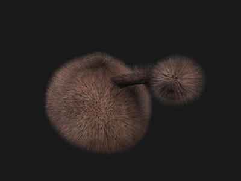

# Fur

"Fur" shaders allow a surface to replicate itself or another shader above its surface in multiple layers. Care should be taken when using fur shaders, they can quickly cause drops in performance.



## q3map\_cloneShader

[q3map\_cloneShader](#q3map_cloneShader) allows the base shader to inherit the target shader's properties and appearance. Beware not to reference another cloning shader or itself as this can lead to an infinite loop. For fur, the base shader is the texture applied to the polygon surface.

```
// base texture
textures/fur/pink_base
{
	// points to the fur shader (see below)
	q3map_cloneshader textures/fur/pink_fur
	{
		map $lightmap
	}
	{
		map textures/fur/pink_base.tga
		blendFunc GL_DST_COLOR GL_ZERO
	}
}
```

## q3map\_fur

[q3map\_fur](#q3map_fur) generates additional surfaces above the base shader. The [q3map\_fur](#q3map_fur) directive takes a few values: layers, offset and fade. Layers controls the number of surfaces generated (start with low values, high values will very quickly cause a reduction in performance). Offset controls the distance between layers. Fade controls how much each additional layer fades in addition to its previous layer. The fur shader shouldn't be applied to surface geometry as it is implicitly generated above the base shader.

```
// fur texture
textures/fur/pink_fur
{
	q3map_lightimage textures/fur/pink_fur.q3map.tga

	q3map_notjunc
	q3map_nonplanar
	q3map_bounce 0.0
	q3map_shadeangle 120

	// format: q3map_fur <layers> <offset> <fade>
	q3map_fur 8 1.25 0.1

	surfaceparm trans
	surfaceparm pointlight
	surfaceparm alphashadow
	surfaceparm nonsolid
	surfaceparm noimpact

	nomipmaps
	{
		map textures/fur/pink_fur.tga
		//alphaFunc GE128
		blendFunc GL_SRC_ALPHA GL_ONE_MINUS_SRC_ALPHA
		rgbGen vertex
	}
}
```
