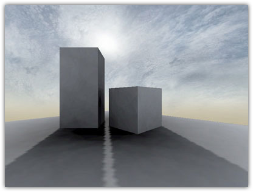
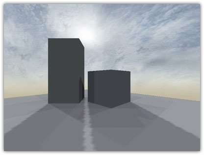
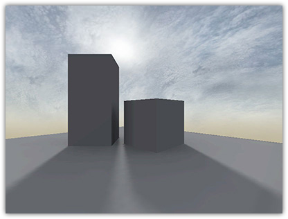

# Light Emitting Shaders

Q3Map2 surface light and sky shaders are quite different than the
original Quake III shaders. As new lighting algorithms were introduced,
new shader keywords were created to accompany or replace the original
keywords. This section will illustrate the differences between these
shaders.

## Surface Lights

(Pending)

## Skies

Originally, sky shaders were just very large [surface
lights](#q3map_surfaceLight) that casted
parallel directional lighting. With Q3Map2, there are a few differences
that sets sky shaders apart from surface lights. First of all, we\'ll
take a look at how the pre-Q3Map2 shaders were set up:

    textures/shadermanual/sky
    {
        //farbox cloudheight nearbox
        skyparms textures/shaderlab_terrain/env/sky 1024 -

        q3map_lightImage textures/shaderlab_terrain/sky_clouds.tga

        q3map_sun 1 1 1 140 -35 25  //red green blue intensity degrees elevation
        q3map_lightSubdivide 256    //sets non-default surface light granularity
        q3map_surfaceLight 200      //emits 200 units of light

        surfaceparm sky             //flags compiler that this is sky
        surfaceparm noimpact
        surfaceparm nolightmap
        surfaceparm nodlight

        nopicmip
        nomipmaps

        qer_editorimage textures/shaderlab_terrain/sky_clouds.tga

        {
            map textures/shaderlab_terrain/sky_clouds.tga
            tcMod scale 3 3
            //tcMod scroll 0.005 -0.0125
            rgbGen identityLighting
        }
        {
            map textures/shaderlab_terrain/sky_arc_masked.tga
            blendFunc GL_ONE_MINUS_SRC_ALPHA GL_SRC_ALPHA
            tcMod transform 0.25 0 0 0.25 0.1075 0.1075
            rgbGen identityLighting
        }
    }

Keep in mind that this is a generalized shader, and that there can be a
lot of different variations to yield different effects. Take a look at
some of the original Quake III Arena shaders for more examples. In this
screenshot (compiled with LIGHT -fast, viewed with /r_lightmap 1), the
effect isn\'t bad, but the shadows are a bit jagged.

{.center
tppabs="http://robotrenegade.com/q3map2/docs/shader_manual/_images/sky01.jpg"
width="416" height="316"}

Q3Map2 sky shaders improves on the way lightmaps are calculated,
improving both quality and compiler performance. This is essentially the
same shader with some small changes:

    textures/shadermanual/sky
    {
        skyparms textures/shaderlab_terrain/env/sky 1024 -

        q3map_lightImage textures/shaderlab_terrain/sky_clouds.tga

        q3map_sun 1 1 1 140 -35 25
        q3map_skylight 100 3          //amount iterations

        surfaceparm sky
        surfaceparm noimpact
        surfaceparm nolightmap
        surfaceparm nodlight

        nopicmip
        nomipmaps

        qer_editorimage textures/shaderlab_terrain/sky_clouds.tga

        {
            map textures/shaderlab_terrain/sky_clouds.tga
            tcMod scale 3 3
            //tcMod scroll 0.005 -0.0125
            rgbGen identityLighting
        }
        {
            map textures/shaderlab_terrain/sky_arc_masked.tga
            blendFunc GL_ONE_MINUS_SRC_ALPHA GL_SRC_ALPHA
            tcMod transform 0.25 0 0 0.25 0.1075 0.1075
            rgbGen identityLighting
        }
    }

What we\'ve done here is replace
[q3map_lightSubdivide](#q3map_lightSubdivide)
and
[q3map_surfaceLight](#q3map_surfaceLight)
with [q3map_skylight](#q3map_skylight) which
yields more uniform shadows at a fraction of the compile time. However,
this also generates the \"stadium light\" effect - producing some
unwanted shadows. We\'ll fix this later.

{.center
tppabs="http://robotrenegade.com/q3map2/docs/shader_manual/_images/sky02.jpg"
width="416" height="316"}

To solve the problem with jagged shadow edges, we can smooth out the
shadows by blurring the lightmap. Depending on the type of lighting that
you want to achieve for the sun (a cloudy day, for example), you can
create a penumbra (half-shadow) effect using
[q3map_sunExt](#q3map_sunExt). This
simulates the way sunlight bounces in certain conditions, creating a
slight \"jittering\" effect. This is the same shader again with
[q3map_sunExt](#q3map_sunExt).

    textures/shadermanual/sky
    {
        skyparms textures/shaderlab_terrain/env/sky 1024 -

        q3map_lightImage textures/shaderlab_terrain/sky_clouds.tga

        q3map_sunExt 1 1 1 140 -35 25 3 16     //adds deviance and samples
        q3map_skylight 100 3

        surfaceparm sky
        surfaceparm noimpact
        surfaceparm nolightmap
        surfaceparm nodlight

        nopicmip
        nomipmaps

        qer_editorimage textures/shaderlab_terrain/sky_clouds.tga

        {
            map textures/shaderlab_terrain/sky_clouds.tga
            tcMod scale 3 3
            //tcMod scroll 0.005 -0.0125
            rgbGen identityLighting
        }
        {
            map textures/shaderlab_terrain/sky_arc_masked.tga
            blendFunc GL_ONE_MINUS_SRC_ALPHA GL_SRC_ALPHA
            tcMod transform 0.25 0 0 0.25 0.1075 0.1075
            rgbGen identityLighting
        }
    }

In the following screenshot, you can see that the jagged shadow edges
are gone.

{.center
tppabs="http://robotrenegade.com/q3map2/docs/shader_manual/_images/sky03.jpg"
width="416" height="316"}

As mentioned above, you may be faced with problems involving the
\"stadium lights\" effect when using
[q3map_skylight](#q3map_skylight). We can
eliminate this problem by using higher values for the
[q3map_sunExt](#q3map_sunExt) samples and
[q3map_skylight](#q3map_skylight) iterations
parameter, but at the cost of a higher compile time. For example,
q3map_sunExt 1 1 1 140 -35 25 3 32 and q3map_skylight 100 6.

> #### Note:
>
> Since the time that these screenshots were taken, the skylight
> subdivision code has been greatly improved (Q3Map2 2.5.14) for far
> more uniform lighting and faster compiles, so using higher iteration
> values can result in better quality, reducing the \"stadium light\"
> effect and without necessarily increasing compile times.

{.center
tppabs="http://robotrenegade.com/q3map2/docs/shader_manual/_images/sky04.jpg"
width="416" height="316"}

A faster approximate alternative of getting rid of the \"stadium
lights\" effect is to use
[q3map_lightmapFilterRadius](#q3map_lightmapFilterRadius).

    textures/shadermanual/sky
    {
        skyparms textures/shaderlab_terrain/env/sky 1024 -

        q3map_lightImage textures/shaderlab_terrain/sky_clouds.tga

        q3map_sunExt 1 1 1 140 -35 25 3 16
        q3map_lightmapFilterRadius 0 8    //self other
        q3map_skyLight 100 3

        surfaceparm sky
        surfaceparm noimpact
        surfaceparm nolightmap
        surfaceparm nodlight

        nopicmip
        nomipmaps

        qer_editorimage textures/shaderlab_terrain/sky_clouds.tga

        {
            map textures/shaderlab_terrain/sky_clouds.tga
            tcMod scale 3 3
            //tcMod scroll 0.005 -0.0125
            rgbGen identityLighting
        }
        {
            map textures/shaderlab_terrain/sky_arc_masked.tga
            blendFunc GL_ONE_MINUS_SRC_ALPHA GL_SRC_ALPHA
            tcMod transform 0.25 0 0 0.25 0.1075 0.1075
            rgbGen identityLighting
        }
    }

The self and other parameters are the amount of filtering applied on the
lightmap in world units. The self value is always set to \"0\" on sky
shaders since skies don\'t have lightmaps. The
[q3map_lightmapFilterRadius](#q3map_lightmapFilterRadius)
directive should always be placed before any light-related directives
that you want it to affect. In our case, we placed it after
[q3map_sunExt](#q3map_sunExt) and before
[q3map_skylight](#q3map_skylight) so that it
filters the stadium lights, but won\'t blur the sun shadows which are
already jittered. This produces very similar results without the long
compile times.

{.center
tppabs="http://robotrenegade.com/q3map2/docs/shader_manual/_images/sky05.jpg"
width="416" height="316"}

Reference: Obsidian (2004). [Shader Lighting
Experiment](http://www.quake3world.com/ubb/Archives/Archive-000004/HTML/20040311-6-027331.html?){tppabs="http://www.quake3world.com/ubb/Archives/Archive-000004/HTML/20040311-6-027331.html?"},
Quake3World (link currently down, [see
here](http://web.archive.org/web/20050412214328/www.quake3world.com/ubb/Archives/Archive-000004/HTML/20040311-6-027331.html){tppabs="http://web.archive.org/web/20050412214328/www.quake3world.com/ubb/Archives/Archive-000004/HTML/20040311-6-027331.html"}).

## Lighting Effects

(Pending)
