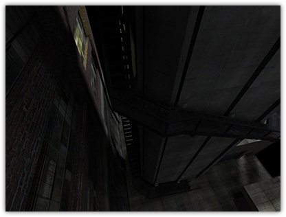

# Lightstyles

Q3Map2 light styles are a way to simulate flickering/blinking dynamic
lights by modulating values between up to 3 different dynamic lightmap
styles per surface. This feature was added in Q3Map2 to support Quake 3
and RTCW. SOF2/JK2 already have native support for light styles. Light
styles will only affect lightmapped objects, it has no effect on vertex
lit objects and the light grid.

{.center
tppabs="http://robotrenegade.com/q3map2/docs/shader_manual/_images/lightstyles.jpg"
width="416" height="316"}

## Worldspawn Keys

To create some flickering lights, we need some [waveform
functions](#waveformfunctions). These are set on the
worldspawn entity in Radiant\'s Entity Inspector using two new available
key/value pairs: \_style*N*rgbGen and \_style*N*alphaGen keys, where
\"N\" is the style index number, an integer between 1 and 31. Both keys
will take [standard waveform
functions](#waveformfunctions){tppabs="http://robotrenegade.com/q3map2/docs/shader_manual/#waveformfunctions"}
as values. As an example:

    _style1alphaGen    wave sin .5 .3 .25 1.5
    _style1rgbGen      wave noise 0.5 1 0 5.37
    _style2alphaGen    wave sin .8 .3 .25 1.5
    _style2rgbGen      wave square -.3 1.3 0 5.3
    classname          worldspawn

## Lights

Next, we need to associate your lights with the style index numbers that
were set in the worldspawn. You can add light styles to either light
entities or light emitting shaders.

### Light Entities

With a light entity selected, open up the Entity Inspector and add a
\"style\" key. Use a value between 1 and 31 matching the style index
number previously set in the worldspawn.

### Light Emitting Shaders

You can also use
[q3map_lightStyle](#q3map_lightStyle) N,
where \"N\" is a value between 1 and 31 matching the style index number
set in the worldspawn, on light-emitting shaders to have them emit
styled light.

    textures/slstyle/light
    {
        q3map_surfacelight 3700
        q3map_lightStyle 1    // sets style index #1
        {
            map $lightmap
            rgbGen identity
        }
        q3map_styleMarker     // note: after the $lightmap stage
        {
            map textures/slstyle/light.tga
            blendFunc GL_DST_COLOR GL_ZERO
            rgbGen identity
        }
        {
            map textures/slstyle/light.blend.tga
            blendfunc GL_ONE GL_ONE
        }
    }

## Lightmapped Surfaces

For any shaders that may be hit by a styled light, you\'ll need to add
[q3map_styleMarker](#q3map_styleMarker)
after the lightmap stages and before the texture stages so Q3Map2 can
properly create the fake lightmap stages. For masked textures where a
depthFunc equal is required, add
[q3map_styleMarker2](#q3map_styleMarker2).

Shaders with lightmaps after texture passes will look odd. This may
change in the future. Try to rearrange your shaders, if possible, to
have lightmaps first.

    textures/slstyle/plywood2sided
    {
        cull none
        qer_editorImage textures/slstyle/plywood-2-tone.tga
        {
            map $lightmap
            rgbGen identity
        }
        q3map_styleMarker     // note: after the $lightmap stage
        {
            map textures/slstyle/plywood-2-tone.tga
            blendFunc GL_DST_COLOR GL_ZERO
            rgbGen identity
        }
    }

## Compiling

Compile your map with Q3Map 2.5.5-test-6 or later. Be sure to use the
-nocollapse switch in the -light phase. This is important, because
styled lights generate shaders, and this minimizes the number of unique
shaders.

In game, you might get a warning message in the console, \"WARNING:
reused image \*lightmap4 with mixed glWrapClampMode parm\", which you
can safely ignore.

### References

- [Q3Map 2.5.5-test-6
  (lightstyles)](http://www.splashdamage.com/forums/showthread.php?t=1857){tppabs="http://www.splashdamage.com/forums/showthread.php?t=1857"},
  ydnar 2003
- [slstyle demo
  map](http://shaderlab.com/q3map2/samples/map-slstyle.zip){tppabs="http://shaderlab.com/q3map2/samples/map-slstyle.zip"}
  ([mirror](http://robotrenegade.com/q3map2/downloads/samples/maps/map-slstyle.zip){tppabs="http://robotrenegade.com/q3map2/downloads/samples/maps/map-slstyle.zip"}),
  ydnar 2003.
