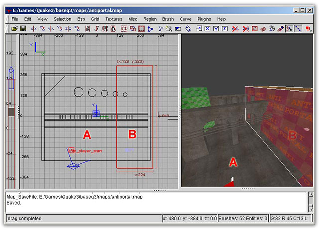

# Q3Map Surface Parameter Directives

All surfaceparm keywords are preceded by the word surfaceparm as
follows: [surfaceparm fog](#fog)
or [surfaceparm
noimpact](#noimpact).

These keywords change the physical nature of the textures and the
brushes that are marked with them. Changing any of these values will
require the map to be re-compiled. These are global and affect the
entire shader.

It should be noted that some of these surface parameters will change
both the surface as well as the content of an object ([surfaceparm
water](#water), for example).
Shaders containing content altering surface parameters should usually be
used on all sides of the object.

Many of these keywords are only used in \"common\" shaders
(baseq3/scripts/common.shader), which are editor specific shaders used
by the level designer. Such keywords are usually not used for the design
of custom assets.

Originally, surfaceparm\'s were part of the previous chapter since they
are actually Q3Map2 specific keywords. I\'ve moved them into their own
chapter for the sake of being easier to reference, since both this and
the previous chapter were getting too long.

## surfaceparm alphashadow {#alphashadow}

This keyword applied to a texture on a brush, patch or model will cause
the lighting phase of the Q3Map2 process to use the texture\'s alpha
channel as a mask for casting static shadows in the game world.

> #### 
>
> #### Design Notes:
>
> Alphashadow does not work well with fine line detail on a texture.
> Fine lines may not cast acceptable shadows. It appears to work best
> with well-defined silhouettes and wider lines within the texture. Most
> of our tattered banners use this to cast tattered shadows.
>
> With Q3Map2, it is possible to increase the resolution of the lightmap
> receiving the shadows at the cost to video memory. This can be
> achieved with the
> [q3map_lightmapSampleSize](#q3map_lightmapSampleSize)
> keyword on the shadow receiving shader or by creating a func_group of
> the shadow receiving brushes and adding the \_lightmapScale key with a
> floating-point value for the scale of the lightmap.

## surfaceparm antiportal {#antiportal}

Works like hint brushes in that it creates BSP nodes, but unlike hint,
it blocks vis by not creating a portal at the split. This is designed to
be used with large terrain maps to block visibility without having to
resort to tricks like sky or caulk brushes penetrating the terrain and
throwing ugly shadows.

{.center
tppabs="http://robotrenegade.com/q3map2/docs/shader_manual/_images/antiportal_sm.jpg"}

Players in part A of the map will not be able to see into part B and
vice-versa. You can walk through the antiportal just fine. Note that
this also blocks light. There are two caveats: They are opaque to light,
and if aligned to another BSP cut (such as blocksize or the origin) they
will not function correctly. Don\'t align it with anything else (like
blocksize or another brush face) and it\'ll block vis. This keyword is
found in \"common/antiportal\" so you shouldn\'t need to specify this.
\"common/antiportal\" was added by ydnar, so if you\'re missing this
shader, it is included with the latest version of Q3Map2.

## surfaceparm areaportal {#areaportal}

A brush marked with this keyword functions as an areaportal, a break in
the BSP tree. It is typically placed on a very thin brush placed inside
a door entity (but is not a part of that entity). The intent is to block
the game from processing surface triangles located behind it when the
door is closed. Blocked area ought to be wholly enclosed and only
accessible via areaportals. It is also used by the BSPC (bot area file
creation compiler) in the same manner as a
[clusterportal](#clusterportal).
The brush must touch all the structural brushes surrounding the
areaportal. This keyword is found in \"common/areaportal\" so you
shouldn\'t need to specify this.

## surfaceparm botclip {#botclip}

Blocks bot movement only. Other game world entities and human players
can pass through a brush marked botclip. The intended use for this is to
block the bot but not other players or projectiles. This keyword is
found in \"common/botclip\" so you shouldn\'t need to specify this.

> #### Design Notes:
>
> Careful use of botclip in a map can greatly reduce the complexity of
> the .aas bot navigation file, resulting in \"smarter\", more efficient
> bots.

## surfaceparm clusterportal {#clusterportal}

A brush marked with this keyword function creates a subdivision of the
area file (.aas) used by the bots for navigation. It is typically placed
in locations that are natural breaks in a map, such as entrances to
halls, doors, tunnels, etc. The intent is keep the bot from having to
process the entire map at once. As with the the
[areaportal](#areaportal)
parameter, the affected brush must touch all the structural brushes
surrounding the clusterportal. This keyword is found in
\"common/clusterportal\" so you shouldn\'t need to specify this.

## surfaceparm detail {#detail}

This surface attribute causes a brush to be ignored by the Q3Map2
process for generating possible break-points in the BSP tree. Generally
speaking, detail brushes are usually set in the editor, so you
shouldn\'t need to specify this.

## surfaceparm donotenter {#donotenter}

Read as \"do not enter\". Like
[clusterportal](#clusterportal),
this is a bot-only property. A brush marked with donotenter will not
affect non-bot players, but bots will not enter it. It should be used
only when bots appear to have difficulty navigating around some map
features. This does not physically stop the bot from entering a region
(as with [botclip](#botclip)).
Bots will not enter the area on their own but may, for example, be
blasted into the region with a rocket launcher. This keyword is found in
\"common/donotenter\" so you shouldn\'t need to specify this.

> #### Design Notes:
>
> donotenter can be (sparingly) used in space maps around the void or
> around lava/slime in certain places where bots have an overwhelming
> tendency to commit suicide (lemming style).

## surfaceparm dust {#dust}

Team Arena specific: if a player lands on a surface that uses a shader
with this parameter, a puff of dust will appear at the player\'s feet.
Note that the worldspawn entity must contain the \"enabledust\" key with
a set value of \"1\".

## surfaceparm flesh {#flesh}

This will cue different sounds (in a similar manner to
[metalsteps](#metalsteps)) and
cause blood to appear instead of bullet impact flashes. Actually, the
code for this was never fully implemented by id Software. It remains
half-finished so unfortunately it doesn\'t work.

## surfaceparm fog {#fog}

fog defines the brush as being a \"fog\" brush. This is a Q3Map2
function that chops and identifies all geometry inside the brush. The
general shader keyword [fogParms](#fogParms) must
also be specified to tell how to draw the fog.

## surfaceparm hint {#hint}

When Q3Map2 calculates the vis data, it tries to place portals in places
in the map in an attempt to limit the potential viewable set (PVS).
Brushes marked by a hint shader are used to manually place portals to
force a break in the PVS. This keyword is found in \"common/hint\" so
you shouldn\'t need to specify this.

## surfaceparm ladder {#ladder}

Supposedly used to allow the player to climb vertically. This is not
functional in Quake III Arena.

## surfaceparm lava {#lava}

Assigns lava content properties to a brush.

## surfaceparm lightfilter {#lightfilter}

Causes the Q3Map2 light stage to use the texture\'s RGB and alpha
channels to generate colored alpha shadows in the lightmap. For example,
this can be used to create the colored light effect cast by stained
glass windows. This can be used with [surfaceparm
alphashadow](#alphashadow).

## surfaceparm lightgrid {#lightgrid}

The min/max bounds of brushes with this shader in a map will define the
bounds of the map\'s lightgrid (model lighting). Make it as small as
possible around player space to minimize bsp size and compile time. This
keyword is found in \"common/lightgrid\" so you shouldn\'t need to
specify this. \"common/lightgrid\" was added by ydnar, so if you\'re
missing this shader, it is included with the latest version of Q3Map2.

## surfaceparm metalsteps {#metalsteps}

The player sounds as if he is walking on clanging metal steps or
gratings. Other than specifying
[flesh](#flesh) (doesn\'t work),
metalsteps, [nosteps](#nosteps),
or default (i.e. specify nothing) it is currently not possible for a
designer to create or assign a specific sound routine to a texture.
Note: If no sound is set for a texture, then the default footsteps sound
routines are heard.

## surfaceparm monsterclip {#monsterclip}

Blocks monster movement. Not functional in Quake III Arena.

## surfaceparm nodamage {#nodamage}

The player takes no fall damage if he lands onto a texture with this
surfaceparm. This keyword is found in \"common/cushion\" but you may
want to specify this on certain shaders (jump pads, for example).

## surfaceparm nodlight {#nodlight}

Read as \"No Dee-Light\". A texture containing this parameter will not
be affected or lit by dynamic lights, such as weapon effects. An example
in Quake III Arena would be solid lava.

## surfaceparm nodraw {#nodraw}

A texture marked with nodraw will not visually appear in the game world.
Most often used for triggers, clip brushes, origin brushes, on invisible
sides of brushes with with [cull none](#cull)
shaders and so on. This keyword is found in \"common/nodraw\" so you
shouldn\'t need to specify this.

## surfaceparm nodrop {#nodrop}

When a player dies inside a volume (brush) marked nodrop, no weapon is
dropped. The intend use is for \"Pits of Death.\" Have a kill trigger
inside a nodrop volume, and when the players die here, they won\'t drop
their weapons. The intent is to prevent unnecessary polygon pileups on
the floors of pits. This keyword is found in \"common/nodrop\" but you
may want to specify this on certain shaders (fog volumes in pits, for
example).

## surfaceparm noimpact {#noimpact}

World entities will not impact on this texture. No explosions occur when
projectiles strike this surface and no marks will be left on it. Sky
textures are usually marked with this texture so those projectiles will
not hit the sky and leave marks.

## surfaceparm nomarks {#nomarks}

Projectiles will explode upon contact with this surface, but will not
leave marks. Blood will also not mark this surface. This is useful to
keep lights from being temporarily obscured by battle damage.

> #### Design Notes:
>
> Use this on any surface with a deformVertexes keyword. Otherwise, the
> marks will appear on the unmodified surface location of the texture
> with the surface wriggles and squirms through the marks.

## surfaceparm nolightmap {#nolightmap}

This texture does not have a lightmap phase.

## surfaceparm nosteps {#nosteps}

The player makes no sound when walking on this texture.

## surfaceparm nonsolid {#nonsolid}

This attribute indicates a brush or patch, which do not block the
movement of entities in the game world. It applied to triggers, hints,
etc.

## surfaceparm origin {#origin}

Used on the \"origin\" texture. Rotating entities need to contain an
origin brush in their construction. The brush must be rectangular (or
square). The origin point is the exact center of the origin brush. This
keyword is found in \"common/origin\" so you shouldn\'t need to specify
this.

## surfaceparm playerclip {#playerclip}

Blocks player movement through a nonsolid texture. Other game world
entities can pass through a brush marked playerclip. The intended use
for this is to block the player but not block projectiles like rockets.
This keyword is found in \"common/clip\" so you shouldn\'t need to
specify this.

> #### Design Notes:
>
> playerclip is often useful for \"smoothing\" out the geometry of the
> map, preventing the player from snagging on objects. It is also used
> in open sky areas of maps, preventing the player from flying too high
> and seeing the \"Hall of Mirrors\" effect at the bottom of the cloud
> layer.

## surfaceparm pointlight {#pointlight}

Surfaces using a shader with this parameter will always be vertex lit.
This option can be used to reduce the lightmap data. It is often used on
surfaces that don\'t need shadows. Basically the same as [surfaceparm
nolightmap](#nolightmap).

## surfaceparm skip {#skip}

Works just like Quake II skip texture. Use on sides of
[hint](#hint),
[antiportal](#antiportal) and
[areaportal](#areaportal) brushes
where you don\'t want BSP splits. Usual use is 5 faces of skip + 1
functional face. This keyword is found in \"common/skip\" so you
shouldn\'t need to specify this. \"common/skip\" was added by ydnar, so
if you\'re missing this shader, it is included with the latest version
of Q3Map2.

## surfaceparm sky {#sky}

This flags the compiler, telling it that this surface should be rendered
as sky.

## surfaceparm slick {#slick}

This surfaceparm included in a texture should give it zero friction and
air type of acceleration, while standing on it. This keyword is found in
\"common/slick\" but you may want to specify this on certain shaders
(ice, for example).

## surfaceparm slime {#slime}

Assigns slime content properties to a brush.

## surfaceparm structural {#structural}

This surface attribute causes a brush to be seen by the Q3Map2 process
as a possible break-point in a BSP tree. It is used as a part of the
shader for the \"hint\" texture. Generally speaking, any opaque texture
not marked as \"detail\" is, by default, structural, so you shouldn\'t
need to specify this.

## surfaceparm trans {#trans}

Tells Q3Map2 that pre-computed visibility and light should not be
blocked by this surface. Generally, any shaders that have
[blendFunc](#blendFunc)\'s should be marked as
surfaceparm trans.

## surfaceparm trigger {#trigger}

Implies transparent and nonsolid inside q3map2. Is not necessary for the
game, as it assigns this flag basing on entity type.

## surfaceparm water {#water}

Assigns water content properties to a brush.
